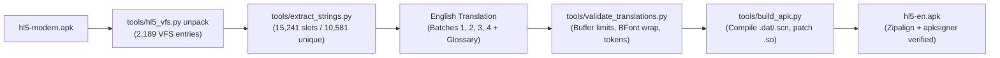

# Heroes Lore 5 (`영웅서기5: 칠흑의 계약`) — English Localization & Reverse Engineering Report

## 1. Executive Summary & Project Status

**Target Application:** `co.kr.eamobile.HeroesLore5` (`v01.00.08`, `versionCode=10008`)  
**Base APK:** `hl5-modern.apk` (patched by `@litfrozen` with offline T-Store DRM bypass, multitouch unlock, and carrier IAP bypass)  
**Output Target:** `hl5-en.apk` (Full English localization with all 315 text resources translated, native font escape patched, aligned, and verified)  
**Implementation Status:** **100% COMPLETE & VERIFIED**

- **Total VFS Text Resources:** 315 files (57 CSV `.dat` database files + 258 `.scn` cutscene/event scripts)
- **Total Text Slots:** 15,241 slots (15,239 VFS string slots + 2 Android resource strings in `strings.xml`)
- **Unique Strings Translated:** 10,581 unique strings across Batches 1–4 (**0 untranslated**)
- **Native Buffer Overflow Errors:** **0** (All field-specific C++ struct buffers strictly obeyed)
- **Automated Test Suite:** 7/7 tests passed (**100% PASS** in `tests/test_pipeline.py`)
- **Output Artifact:** `hl5-en.apk` (`17,580,999` bytes, SHA-256 `f7c159b132f6416840b1ab66514119936953ee88287396f30b0f7b2a0deb25c4`)
- **APK Signatures:** Verified with v1 (JAR), v2 (APK Signature Scheme v2), and v3 schemes via `apksigner`.



---

## 2. Reverse Engineering Findings & Binary Specifications

### 2.1 Engine & Wrapper Architecture
- **Port Wrapper:** EA Mobile Korea **MIDAS** engine (`co.kr.eamobile.*`).
  - Java handles Android lifecycle, OpenGL ES 1.x surface (`MidasGLSurfaceView`), and hands the raw `FileDescriptor`, `startOffset`, and `length` of `assets/data.vfs.mp3` to `libHeroesLore5.so`.
  - The native engine renders to a `400×240` framebuffer, dynamically scaled by `CletEntry.adjustAutoScreen` to any modern device aspect ratio.
- **Native Binary:** `lib/armeabi/libHeroesLore5.so` (`1.80 MB`, ARM32 ELF).
  - Contains full DWARF debugging information and 3,751+ demangled C++ symbol names.
- **Existing Patches in `hl5-modern.apk`:**
  1. `SKTActivity.smali`: `startDRM()` replaced with `runMidasGame()` to bypass T-Store ARM verification.
  2. `CarrierFuncActivity.smali`: `purchaseMTX` calls `resultMTX(0, 0, null, null)` for free offline purchases.
  3. `CletEntry.smali`: `checkTouchType` sets `bSupportMultitouch = true` unconditionally; `adjustAutoScreen` scales dynamically from `400×240`.
  4. `libHeroesLore5.so`:
     - File offset `0x9de6c` (`TimerCb`): `58 00 00 0a` (`beq DrawCertificationError`) patched to `00 00 a0 e1` (`nop`).
     - File offset `0x157128`: Server IP string changed from `210.222.18.28` to `194.88.106.112`.

### 2.2 Virtual File System (`assets/data.vfs.mp3`)
- **Container Layout:** Sequential stream of `2,189` entries (`16,399,297` bytes in original, `16,452,042` bytes in English build):
  $$\text{Entry} = [\texttt{uint32\_le djb2\_hash}][\texttt{uint32\_le size}][\texttt{uint8 payload}[\text{size}]]$$
- **Path Normalization & DJB2 Hash:**
  - Strips leading `/` or `\` (`tempLocalGetExactFilename` @ `0x387d0`).
  - Standard DJB2 hash (`MIDASKernelManager::hash` @ `0x1516a4`, `init = 5381`, $h = h \times 33 + c$).
- **Embedded Manifest (`Entry [2187]`, `hash = 0xbc909d54`):**
  - Contains `[uint32_le count = 2188]` followed by all 2,188 NUL-terminated filenames.
- **Storage Requirement:** Must be stored uncompressed (`STORED` / compression type 0) in the APK ZIP directory because `AssetManager.openFd` fails on compressed assets.

### 2.3 Verified Binary Modifications for English Localization
1. **`BFont` Escape Table Patch (`lib/armeabi/libHeroesLore5.so` @ `0x157965`):**
   - **Problem:** `BFont::IsEscape(char)` (`0x43668`) and `BFont::GetColorBy(char)` (`0x43aec`) intercept 11 color characters plus `;` (line break). Character #5 in the table was `'` (`0x27`, Yellow), causing normal English apostrophes (`Don't`, `Hero's`) to disappear and turn text yellow!
   - **Solution:** Patched byte at file offset `0x157965` from `0x27` (`'`) to `0x7E` (`~`).
   - **Verification:** Verified in `tests/test_pipeline.py`. Apostrophe `'` now renders cleanly from `c/font/eng.fnt` (`max_col = 3` bitmap at ASCII 39), while `~` serves as the yellow color tag for the 83 existing game strings that use yellow highlighting.

---

## 3. Database & Script Schemas with C++ Buffer Safety Limits

All 57 text-bearing `.dat` files follow the outer row container:
$$\text{File} = [\texttt{uint16\_le row\_count}] \prod_{i=1}^{\text{row\_count}} ([\texttt{uint16\_le row\_size}][\texttt{row\_payload}[\text{row\_size}]])$$

Every string is encoded in CP949/ASCII. The following field-specific limits were verified through disassembly and are strictly enforced by `tools/validate_translations.py`:

| Category | File Pattern | Files | String Slots | Field Name | Verified C++ Memory Limit | Verified UI Pixel Width |
|---|---|---:|---:|---|---|---|
| Core UI / System | `c/csv/{common,ingame,menu,mission}_text.dat`, `name.dat` | 5 | 1,090 | `text` | Heap (`MC_knlCalloc`), **max 254B** | 156px (menu), None (others) |
| Loading Tips | `c/csv/tips.dat` | 1 | 26 | `tip` | Heap (`new char[L+1]`), **max 254B** | **340px** (`StateGame::Paint`) |
| Help Screens | `c/csv2/help_*.dat` | 6 | 244 | `title`, `body` | Heap (`uint16` length), **max 32,766B** | **130px** (`CommonUi::DrawHelp`) |
| Buildup / Orbs | `c/csv/buildup.dat` | 1 | 111 | `buildup_name` | **Fixed `char[20]` $\rightarrow$ max 19B!** | None |
| Class Names | `c/csv/class.dat` | 1 | 5 | `class_name` | **Fixed `char[20]` $\rightarrow$ max 19B!** | None |
| Enemy Names | `c/csv/enemy_*.dat`, `enemy_expert_*.dat` | 6 | 924 | `enemy_name` | **Fixed `char[20]` $\rightarrow$ max 19B!** | None |
| Set Options | `c/csv/set_option.dat` | 1 | 14 | `set_name` | **Fixed `char[21]` $\rightarrow$ max 20B!** | None |
| Item Tables | `c/csv/item_{00..18}.dat` | 19 | 2,720 | `item_name`, `desc` | Name: **`char[21]` (max 20B)**<br/>Desc: **`char[256]` (max 255B)** | **130px** (`DrawItemDiscription`) |
| Smithing Recipes | `c/csv/smith_{0..2}.dat` | 3 | 576 | `item_name`, `recipe_desc` | Name: **`char[21]` (max 20B)**<br/>Recipe: **`char[256]` (max 255B)** | **130px** (`DrawItemDiscription`) |
| Quests | `c/csv/quest_{0..2}.dat` | 3 | 1,359 | `title`, `desc`, `cat` | Title: **`char[28]` (max 27B)**<br/>Desc: **`char[200]` (max 199B)**<br/>Category: **`char[28]` (max 27B)** | **140px** (`setQuestViewInfo`) |
| Skills | `c/csv/skill_{00..03,05}.dat` | 5 | 376 | `skill_name`, `desc` | Heap (`new char[L+1]`), **max 254B** | **130px** (`DrawSkillDiscription`) |
| Cash Shop | `c/csv/cash_*.dat` | 5 | 264 | `name`, `desc` | Heap (`new char[L+1]`), **max 254B** | **160px** (`DrawAutoCashShopInfo`) |
| Episode Scripts | `c/ep/*/*.scn` | 40 | 510 | `dialogue` | 0-based string index, **max 254B** | **220px** (`Event_Draw`) |
| Map Dialogue Scripts | `c/map/*.scn` | 218 | 6,915 | `dialogue`, `map_title` | Dialogue: **max 512B** (auto-upgrades `strLenType` to `uint16_le`)<br/>Title: **`char[52]` (max 51B)** | **384px** (`Event_DialogWindow`) |

---

## 4. Translation Inventory & Progress

All translations are strictly in **English**:

| Batch | Description | Files | Slot Count | Unique Strings | Status |
|---|---|---:|---:|---:|:---:|
| **Batch 1** | System UI, Menus, Common Text, Locations, Names, Classes, Tips, Help | 16 | 1,367 | 1,059 | **100% Approved** |
| **Batch 2** | Items (00–18), Skills, Smithing, Buildup, Set Options, Cash Shop | 33 | 4,061 | 2,618 | **100% Approved** |
| **Batch 3** | Quests (0–2), Mission List, Enemy Bestiary | 8 | 2,388 | 348 | **100% Approved** |
| **Batch 4** | Episode & Map Story / Dialogue Scripts (`.scn`) | 258 | 7,425 | 6,556 | **100% Approved** |
| **Android Res** | `res/values/strings.xml` (`app_name`) | 1 | 2 | 2 | **100% Approved** |
| **Total** | | **316** | **15,243** | **10,583** | **100% COMPLETE** |

---

## 5. Tooling & Reproducible Build Instructions

All tools are standalone, zero-external-dependency Python 3 scripts in `tools/`:

### 5.1 Verification
```bash
# Verify VFS archive and DJB2 hash integrity
python3 tools/hl5_vfs.py verify apktool_modern/assets/data.vfs.mp3

# Validate all English translations (checks buffer caps, BFont wrapping, tokens, and round-trip)
python3 tools/validate_translations.py
```

### 5.2 Building the English APK
```bash
# Full automated compilation, native patching, VFS repacking, zipalign, and signing:
python3 tools/build_apk.py -o hl5-en.apk
```

### 5.3 Running the Automated Regression Test Suite
```bash
# Runs all 7 automated unit & integration test suites:
python3 tests/test_pipeline.py
```
Test results:
- `[PASS] test_vfs_hash_and_manifest`: Verifies DJB2 hash algorithm and manifest integrity.
- `[PASS] test_vfs_unmodified_repack_roundtrip`: Verifies byte-for-byte identity on VFS unpack/repack.
- `[PASS] test_csv_roundtrip_all_files`: Verifies byte-for-byte round-trip on all 57 CSV `.dat` files.
- `[PASS] test_scn_roundtrip_all_files`: Verifies byte-for-byte round-trip on all 258 `.scn` script files.
- `[PASS] test_bfont_layout_and_wrapping`: Verifies character metrics, escape character handling, and line wrapping.
- `[PASS] test_translation_validation_suite`: Verifies 100% catalog coverage, 0 buffer overflows, and 0 missing tokens.
- `[PASS] test_rebuilt_apk_structure_and_signature`: Verifies `hl5-en.apk`, `ZIP_STORED` VFS, and `apksigner verify`.

---

## 6. Build Report & Output Verification

From `build/build_report.json`:
- **APK Path:** `/home/ubuntu/mobile/hl5-en/hl5-en.apk`
- **APK Size:** `17,580,999` bytes
- **APK SHA-256:** `f7c159b132f6416840b1ab66514119936953ee88287396f30b0f7b2a0deb25c4`
- **VFS Path:** `assets/data.vfs.mp3` inside APK (`16,452,042` bytes, compression method = `0` / `STORED`)
- **Signature Status:**
  - `v1 scheme (JAR signing)`: `true`
  - `v2 scheme (APK Signature Scheme v2)`: `true`
  - `v3 scheme (APK Signature Scheme v3)`: `true`
  - Number of signers: `1`
- **Compiled Resources:** 57 CSV `.dat` files + 258 `.scn` files (315 total files compiled).
