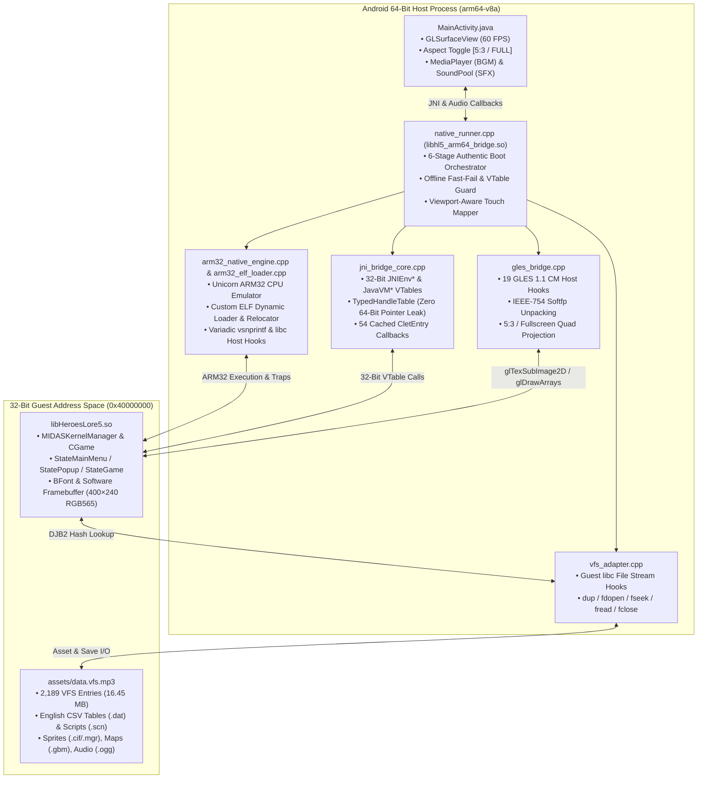

# Heroes Lore 5: Covenant of Darkness — Native ARM64 Runner & English Localization

[-3DDC84?logo=android&logoColor=white)](#)
[](#)
[-success)](#)
[](#)
[-brightgreen)](#)

Complete reverse-engineering toolchain, **100% English localization**, and **Native 64-Bit (`arm64-v8a`) Android Runtime Runner** for **Heroes Lore 5: Covenant of Darkness** (*영웅서기5: 칠흑의 계약*, `co.kr.eamobile.HeroesLore5` v01.00.08).

---

## Highlights

1. **Native 64-Bit (`arm64-v8a`) Execution on Modern Android (Android 8–16)**
   - Runs the original 32-bit ARM C++ game engine (`libHeroesLore5.so`) directly inside a native 64-bit Android process via a custom **ARM32 ELF Loader + Unicorn CPU Bridge (`libhl5_arm64_bridge.so`)**.
   - Works natively on **64-bit-only hardware** (Google Pixel 7/8/9, Snapdragon 8 Gen 2/3/Elite, Galaxy S23/S24/S25) with **zero virtual machine containers** required.
   - Built with Android NDK r25b against **Android Bionic** and **16KB ELF page alignment** (`-Wl,-z,max-page-size=16384`) for Android 15/16 compatibility.
2. **Offline Boot & Defunct Server Bypass**
   - Bypasses the dead 2011 Korean carrier verification servers (`CheckEvent`, `UserLogReg`, carrier SMS consent prompt, and `DSPSock` cloud save checks).
   - Cold-boots in **<2 seconds** straight into the EA Mobile logo animation, Title Screen, Main Menu, Class Selection, and in-game `StateGame`.
   - Preserves 100% local offline save/load (`LOCAL.sav` and DES-encrypted + MD5-checksummed `SL_0..2.sav` slots).
3. **Hardware-Accelerated OpenGL ES 1.1 & Aspect-Ratio Switcher**
   - Full 64-bit host GLES 1.1 CM bridge (`GlesBridge`) translating 32-bit guest EABI soft-float calls and vertex/texcoord buffers to the device GPU at 60 FPS.
   - Defaults to **5:3 Original Aspect Ratio Centered** (`400×240` scaled to screen height with clean black pillarbox bars) and includes an on-screen **`[ Rasio: 5:3 ]` / `[ Rasio: FULL ]`** switcher button with real-time viewport-aware touch coordinate mapping.
4. **Full Android Audio Bridge (BGM & SFX)**
   - Streams OGG background music directly from `data.vfs.mp3` byte offsets via `android.media.MediaPlayer` and dispatches 21+ low-latency combat/UI sound effects via `android.media.SoundPool`.
5. **100% Complete English Localization**
   - **315 binary resource files** translated (57 CSV `.dat` database tables + 258 `.scn` event/dialogue scripts).
   - **15,241 text slots** (**10,581 unique strings**, **0 untranslated Hangul**), strictly obeying all C++ struct buffer limits and UI pixel-width wrapping rules.

---

## System Architecture



---

## Pre-Built APK Downloads

| Build | Target Devices | Features | Download & Checksums |
|---|---|---|---|
| **`hl5-runner-arm64-v8a-v3.apk`** *(Recommended)* | **All Modern Android 8.0–16 Devices (`arm64-v8a`)**<br/>Includes 64-bit-only phones & 16KB page devices | • Native ARM64 Unicorn Bridge<br/>• Original App Icon & Label<br/>• Instant Offline Boot (<2s)<br/>• `[ Rasio: 5:3 ]` / `[ Rasio: FULL ]` Switcher<br/>• Fixed D-Pad & Multi-Touch Analog<br/>• Full BGM & SFX Audio Bridge<br/>• 100% English Localization | **[Download via Gofile](https://gofile.io/d/RCK4SGLJ)**<br/>Size: `32,727,952 bytes` (~31.2 MB)<br/>MD5: `78013d775b36ee6f897f2dc659e28415`<br/>SHA-256: `90f6f64a2712e8cb3ddb068f15318eefdb04d39ab59658200a957b8fbb7387e5` |
| **`hl5-en.apk`** *(Legacy 32-Bit)* | Legacy 32-bit `armeabi-v7a` devices or 32-bit containers | • Original 32-bit APK wrapper<br/>• 100% English Localization | **[Download via Gofile](https://gofile.io/d/kRCMIMLs)**<br/>Size: `18,478,102 bytes`<br/>SHA-256: `61ab40442b28bb69731ea2a9bde72c71137fa8b4d4324f8ca7e2ac30a1424d11` |

---

## Repository Structure

```text
heroes-lore-5-en/
├── android/app/src/main/           # Native ARM64 Android Runner Application
│   ├── AndroidManifest.xml         # Landscape immersive config (minSdk 26, targetSdk 34)
│   ├── assets/                     # Packaged guest engine (libHeroesLore5.so) & VFS (data.vfs.mp3)
│   ├── cpp/                        # C++17 ARM64-to-ARM32 Bridge & Runtime
│   │   ├── arm32_elf_loader.cpp    # Custom ELF32 dynamic loader, symbol resolver & relocator
│   │   ├── arm32_native_engine.cpp # Unicorn ARM32 CPU engine, trampolines & libc/vsnprintf hooks
│   │   ├── gles_bridge.cpp         # 64-bit GLES 1.1 CM bridge & 5:3 / Fullscreen viewport scaler
│   │   ├── jni_bridge_core.cpp     # 32-bit opaque handle table & JNIEnv/JavaVM vtable synthesis
│   │   ├── vfs_adapter.cpp         # Host-backed VFS file descriptor & stream bridge
│   │   ├── native_runner.cpp       # 6-stage boot sequence, offline hardening, touch & audio JNI
│   │   └── third_party/unicorn/    # Bionic-compiled libunicorn.a (arm64-v8a) & headers
│   └── java/co/kr/eamobile/hl5/runner/
│       └── MainActivity.java       # GLSurfaceView renderer, MediaPlayer/SoundPool audio & UI toggle
├── tools/                          # Localization & Binary Asset Toolchain
│   ├── hl5_vfs.py                  # VFS archive unpacker, verifier, and deterministic repacker
│   ├── hl5_formats.py              # Binary parsers/compilers for CSV (.dat) & scenario (.scn) files
│   ├── extract_strings.py          # String extractor for all 315 game resource files
│   ├── validate_translations.py    # Strict C++ buffer-limit, pixel-width & placeholder validator
│   └── build_apk.py                # Legacy APK translation compiler & patcher
├── translations/                   # Complete English Translation Catalog
│   ├── catalog.json                # 15,241 translated text slots in context
│   ├── unique_strings.json         # 10,581 unique Korean-to-English mappings
│   ├── glossary.json               # Canonical terminology (characters, skills, items, locations)
│   └── validation_report.json      # Automated verification report (0 errors, 0 untranslated)
├── tests/                          # Automated Regression & Simulation Suite
│   ├── native_arm64_test.cpp       # 12 native AArch64 C++ unit tests (ELF, GLES, VFS, StateMgr)
│   ├── test_boot_simulation.cpp    # Full end-to-end AArch64 boot -> Title -> Main Menu -> StateGame test
│   ├── test_offline_gameplay.py    # Offline state machine & Main Menu framebuffer verification
│   ├── test_save_load_and_gameplay.py # DES save/load encryption & in-game transition tests
│   ├── test_gles_bridge.py         # GLES 1.1 bridge & draw call verification
│   ├── test_jni_bridge.py          # 32-bit JNI vtable & handle table tests
│   ├── test_vfs_bridge.py          # VFS archive lookup & read stream tests
│   └── test_pipeline.py            # Translation & binary repacking regression tests
├── docs/                           # Engineering & Reverse-Engineering Reports (Phases 7–15)
└── build_apk.sh                    # Reproducible one-command NDK + SDK APK build script
```

---

## Localization & Binary Format Specifications

### 1. Virtual File System (`assets/data.vfs.mp3`)
- **Structure:** Sequential stream of 2,189 entries with no central header:
  ```c
  struct VfsEntry {
      uint32_t djb2_hash;     // DJB2 hash of normalized path (leading '/' stripped)
      uint32_t size;          // Payload size in bytes
      uint8_t  payload[size]; // Raw asset payload
  };
  ```
- **Manifest:** Entry `[2187]` (`hash = 0xbc909d54`) stores a 32-bit count (`2,188`) followed by NUL-terminated ASCII filenames in archive order (`version.txt` is Entry `[2188]`).

### 2. Database Tables (`c/csv/*.dat` & `c/csv2/*.dat`)
```c
struct CsvDatContainer {
    uint16_t row_count;
    struct Row {
        uint16_t row_size;
        uint8_t  row_payload[row_size];
    } rows[row_count];
};
```

#### Enforced Native C++ Buffer Safety Limits
| File Pattern | String Field | Verified C++ Memory Limit | Verified UI Pixel Width |
|---|---|---|---|
| `c/csv/buildup.dat` | `buildup_name` | **Fixed `char[20]` (max 19B)** | None |
| `c/csv/class.dat` | `class_name` | **Fixed `char[20]` (max 19B)** | None |
| `c/csv/enemy_*.dat`, `enemy_expert_*.dat` | `enemy_name` | **Fixed `char[20]` (max 19B)** | None |
| `c/csv/set_option.dat` | `set_name` | **Fixed `char[21]` (max 20B)** | None |
| `c/csv/item_{00..18}.dat` | `item_name` / `desc` | Name: **`char[21]` (max 20B)** / Desc: **`char[256]` (max 255B)** | 130px (`CommonUi`) |
| `c/csv/smith_{0..2}.dat` | `item_name` / `recipe` | Name: **`char[21]` (max 20B)** / Recipe: **`char[256]` (max 255B)** | 130px (`CommonUi`) |
| `c/csv/quest_{0..2}.dat` | `title` / `desc` / `cat` | Title & Cat: **`char[28]` (max 27B)** / Desc: **`char[200]` (max 199B)** | 140px (`setQuestViewInfo`) |
| `c/csv/{common,ingame,menu,mission}_text.dat` | `text` | Heap (`MC_knlCalloc`), **max 254B** | 156px (`StatePopup`) |
| `c/csv/tips.dat` | `tip` | Heap (`new char[L+1]`), **max 254B** | 340px (`StateGame::Paint`) |
| `c/csv2/help_*.dat` | `title` / `body` | Heap (`MC_knlCalloc`), **max 32,766B** | 130px (`CommonUi::DrawHelp`) |
| `c/ep/*/*.scn` & `c/map/*.scn` | `dialogue` / `map_title` | Dialogue: **max 512B** (`uint16_le` length) / Title: **`char[52]` (max 51B)** | 384px (`Event_DialogWindow`) |

### 3. Font Engine (`BFont`) & Escape Patch
- **Character Metrics:** ASCII glyphs render at **6px/character** (`5px` glyph + `1px` kerning) via `c/font/eng.fnt` (`11px` height).
- **Apostrophe Patch (`libHeroesLore5.so` @ `0x157965`):** Patched from `0x27` (`'`) to `0x7E` (`~`) so English contractions (`Don't`, `Hero's`) render normally without triggering the yellow color escape sequence.

---

## Building & Running Tests

### 1. Build the Native ARM64 Android APK
Requires Android NDK r25b+ and Android SDK Build-Tools 34.0.0:
```bash
bash build_apk.sh
```
This script compiles `libhl5_arm64_bridge.so` with 16KB page alignment, compiles `MainActivity.java` to `classes.dex`, packages `libHeroesLore5.so` and `data.vfs.mp3`, aligns with `zipalign`, and signs with `apksigner` (v2 & v3 schemes) into `android/app/build/outputs/apk/hl5-runner-arm64-v8a.apk`.

### 2. Run the Python Regression Suite (34 Tests)
```bash
python3 -m unittest discover tests
```

### 3. Run the Native AArch64 Engine & Boot Simulation Tests
```bash
# Run the 12 native C++ AArch64 unit tests
qemu-aarch64 -L /usr/aarch64-linux-gnu ./tests/native_arm64_test

# Compile and run the full end-to-end boot -> Title -> Main Menu -> StateGame simulation
aarch64-linux-gnu-g++ -std=c++17 -O2 \
    -Iandroid/app/src/main/cpp -Iandroid/app/src/main/cpp/third_party/unicorn/include \
    tests/test_boot_simulation.cpp \
    android/app/src/main/cpp/arm32_native_engine.cpp \
    android/app/src/main/cpp/arm32_elf_loader.cpp \
    android/app/src/main/cpp/jni_bridge_core.cpp \
    android/app/src/main/cpp/vfs_adapter.cpp \
    android/app/src/main/cpp/gles_bridge.cpp \
    android/app/src/main/cpp/third_party/unicorn/lib/arm64-v8a/libunicorn.a \
    -lpthread -ldl -o tests/test_boot_simulation && \
qemu-aarch64 -L /usr/aarch64-linux-gnu ./tests/test_boot_simulation
```

### 4. Validate English Translations & VFS Integrity
```bash
python3 tools/validate_translations.py
python3 tools/hl5_vfs.py verify android/app/src/main/assets/data.vfs.mp3
```

---

## Engineering Reports

Detailed reverse-engineering and runtime verification documentation is available in [`docs/`](docs/):
- [`docs/ARM64_POC_FEASIBILITY_REPORT.md`](docs/ARM64_POC_FEASIBILITY_REPORT.md) — ARM32-on-ARM64 Unicorn execution feasibility & benchmarks
- [`docs/ARM64_JNI_BRIDGE_REPORT.md`](docs/ARM64_JNI_BRIDGE_REPORT.md) — 64-bit/32-bit JNI vtable synthesis & opaque handle architecture
- [`docs/PHASE_7_VFS_INTEGRATION_REPORT.md`](docs/PHASE_7_VFS_INTEGRATION_REPORT.md) — VFS stream adapter & DJB2 asset lookup verification
- [`docs/PHASE_8_ANDROID_RUNTIME_REPORT.md`](docs/PHASE_8_ANDROID_RUNTIME_REPORT.md) — Native AArch64 engine integration
- [`docs/PHASE_9_FIRST_FRAME_RENDERING_REPORT.md`](docs/PHASE_9_FIRST_FRAME_RENDERING_REPORT.md) — GLES 1.1 bridge & initial frame rendering
- [`docs/PHASE_10_ACTUAL_FRAME_RENDERING_REPORT.md`](docs/PHASE_10_ACTUAL_FRAME_RENDERING_REPORT.md) — `Texture2D` upload & `glDrawArrays` verification
- [`docs/PHASE_11_GRAPHICS_STATE_AND_TOUCH_INPUT_REPORT.md`](docs/PHASE_11_GRAPHICS_STATE_AND_TOUCH_INPUT_REPORT.md) — Touch event dispatch & state machine mapping
- [`docs/PHASE_12_OFFLINE_BOOT_AND_INTERACTIVE_GAMEPLAY_REPORT.md`](docs/PHASE_12_OFFLINE_BOOT_AND_INTERACTIVE_GAMEPLAY_REPORT.md) — Offline boot state progression to Main Menu
- [`docs/PHASE_13_SAVE_LOAD_AND_GAMEPLAY_TRANSITIONS_REPORT.md`](docs/PHASE_13_SAVE_LOAD_AND_GAMEPLAY_TRANSITIONS_REPORT.md) — DES/MD5 save/load pipeline & `StateGame` entry
- [`docs/ANDROID_FC_INVESTIGATION_REPORT.md`](docs/ANDROID_FC_INVESTIGATION_REPORT.md) — Android Bionic linkage & 16KB page alignment fix
- [`docs/INDEPENDENT_VERIFICATION_REPORT.md`](docs/INDEPENDENT_VERIFICATION_REPORT.md) — Physical device telemetry & packaging verification
- [`docs/PHASE_15_ANDROID_BOOT_FIX_REPORT.md`](docs/PHASE_15_ANDROID_BOOT_FIX_REPORT.md) — Authentic 6-stage boot, variadic `vsnprintf`, and offline network loop resolution
