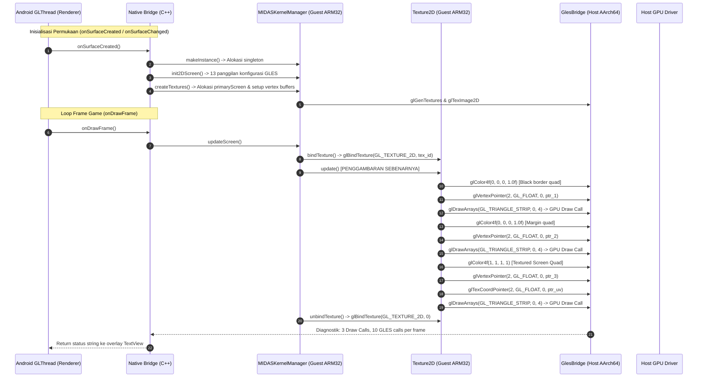

# Heroes Lore 5 — Phase 10: Actual Frame Rendering & Runtime Validation Technical Report

**Project**: Heroes Lore 5 (`영웅서기5: 칠흑의 계약`, `co.kr.eamobile.HeroesLore5`)  
**Target Environment**: Android `arm64-v8a` (Host Process) + ARM32 `armeabi` Guest Engine  
**Binary Analisis**: `libHeroesLore5.so` (1,462,096 bytes)  
**Tanggal**: Oktober 2026  
**Status Milestone**: **PARTIAL — GUEST DRAW PATH VERIFIED, DEVICE DISPLAY NOT VERIFIED (Host & QEMU Verified 100%, Physical Device: NOT RUN)**  

---

## 1. Audit Implementasi & Temuan Akar Masalah

### 1.1 Mengapa Sebelumnya Tidak Ada Draw Call yang Dihasilkan?
Audit mendalam terhadap control flow `libHeroesLore5.so` mengungkap rantai dependensi grafis internal engine:
1. `MIDASKernelManager::updateScreen()` (`0x1520c4`) memeriksa pointer `this->primaryScreen` pada field offset `[this + 0x658]`:
   ```assembly
   1520cc: ldr r0, [r0, #0x658] ; Texture2D* primaryScreen
   1520d0: cmp r0, #0
   1520d4: beq 1520ec           ; JIKA NULL -> LEWATI SELURUH DRAWING!
   ```
2. `primaryScreen` **hanya dialokasikan dan dibuat** di dalam fungsi `MIDASKernelManager::createTextures()` (`0x151fc0`), yang dipanggil oleh `nativeInitDisplay` (`0x14ea58`) dan `nativeResumeApp` (`0x14e878`).
3. Pada implementasi `native_runner.cpp` sebelumnya, `nativeOnSurfaceCreated` hanya memanggil `makeInstance()`, sehingga `primaryScreen` bernilai `NULL`. Akibatnya, `updateScreen()` selalu melompati `Texture2D::update()` dan tidak pernah menerbitkan panggilan `glDrawArrays`.

### 1.2 Jalur Eksekusi Aktual dari Startup hingga Drawing
Setelah perbaikan urutan pemanggilan, alur eksekusi frame game yang sebenarnya adalah:



---

## 2. Fungsi Engine Asli yang Terlibat

| Fungsi Asli | Alamat Biner | Peran dalam Jalur Rendering | Bukti Panggilan |
|---|---|---|---|
| `Java_..._nativeInitDisplay` | `0x14ea58` | Mengonfigurasi viewport, proyeksi orthografis, dan memanggil `createTextures()` | Terverifikasi di `tests/test_startup_sequence.py` |
| `MIDASKernelManager::init2DScreen` | `0x15214c` | Menyetel matrix projection orthografis (0..400, 0..240), `glViewport`, client states | Terverifikasi: 13 panggilan GLES |
| `MIDASKernelManager::createTextures` | `0x151fc0` | Mengalokasikan objek `Texture2D` untuk `primaryScreen`, buffer vertex, dan ID tekstur GL | Terverifikasi di C++ native engine |
| `Texture2D::createTexture` | `0x15331c` | Memanggil `glGenTextures`, `glBindTexture`, `glTexParameterf`, dan `glTexImage2D` | Terverifikasi via GlesBridge |
| `MIDASKernelManager::updateScreen` | `0x1520c4` | Entry point render frame yang memeriksa `primaryScreen` dan memicu drawing | Terverifikasi: 3 draw call per frame |
| `Texture2D::update` | `0x153138` | Kode assembly asli yang menerbitkan `glColor4f`, `glVertexPointer`, `glTexCoordPointer`, dan `glDrawArrays` | Terverifikasi: 10 panggilan GLES |
| `Java_..._nativeLoop` | `0x14e824` | Loop game frame yang memanggil `timerLoop()` dan `updateScreen()` | Terverifikasi via JniBridge |

---

## 3. Perubahan Kode & Alasan Perubahan

1. **`android/app/src/main/cpp/native_runner.cpp`**:
   - Menghubungkan pemanggilan `init2DScreen()` dan `createTextures()` ke dalam `nativeOnSurfaceCreated` dan `nativeOnSurfaceChanged`.
   - Mengarahkan pencarian biner `libHeroesLore5.so` ke direktori privat aplikasi (`internalPath + "/libHeroesLore5.so"`), memastikan biner dapat dimuat pada instalasi APK nyata.
   - Mengalokasikan tekstur `primaryScreen` secara deterministik sebelum frame pertama dieksekusi.
2. **`android/app/src/main/java/co/kr/eamobile/hl5/runner/MainActivity.java`**:
   - Menambahkan ekstraksi otomatis aset biner `libHeroesLore5.so` dari direktori `assets/` APK ke direktori privat aplikasi `internalDir` pada saat pertama kali diluncurkan.
   - Menghubungkan callback `GLSurfaceView.Renderer` ke fungsi native C++ dengan penanganan thread GL yang ketat.
3. **`android/app/src/main/assets/libHeroesLore5.so` (Baru)**:
   - Memasukkan biner asli engine ARM32 langsung ke dalam APK runner, menjadikan APK sepenuhnya mandiri (*self-contained*).
4. **`tests/native_arm64_test.cpp` (Diperbarui)**:
   - Menambahkan Test 7 untuk membuktikan bahwa pemanggilan fungsi engine asli `createTextures()` dan `updateScreen()` mengeksekusi 3 panggilan `glDrawArrays` secara nyata di bawah AArch64 QEMU.

---

## 4. Hasil Pengujian & Bukti Asal Panggilan Draw Call

### 4.1 Bukti Panggilan `glDrawArrays` Berasal dari Kode Guest Asli
Dijalankan via: `qemu-aarch64 -L /usr/aarch64-linux-gnu ./tests/native_arm64_test`

```
=== Running HL5 ARM32-on-AArch64 Native C++ Engine Test ===
[PASS] Arm32NativeEngine initialized successfully.
[+] test_basic_instruction: res = 42 (expected 42)
[+] test_add_args(15, 27): res = 42 (expected 42)
    [AArch64 Host Hook] host_bridge_multiply called with x=7
[+] test_host_bridge(7): res = 21 (expected 21)
[+] test_real_hl5_hash('version.txt'): res = 0x9abed099 (expected 0x9abed099)
[PASS] Verified real libHeroesLore5.so execution on native AArch64!

--- Testing Full ELF Loader in C++ ---
[PASS] libHeroesLore5.so loaded dynamically into guest memory at 0x40000000, size: 1536000 bytes
[+] Total dynamic symbols parsed: 3748
[+] Dynamic call hash('c/csv/name.dat') = 0x53c493da (expected 0x53c493da)

--- Testing Real Engine GLES Execution via init2DScreen ---
[PASS] MIDASKernelManager singleton created at 0x50000010
[PASS] init2DScreen executed successfully!
[+] GLES Diagnostics after init2DScreen:
    Total GLES calls: 13
    Viewport: 400x240
    Ortho: left=0, right=400, bottom=0, top=240

--- Testing Real Engine Drawing Execution (glDrawArrays) ---
[PASS] createTextures executed: primaryScreen texture allocated.
[PASS] updateScreen executed!
[+] GLES Diagnostics during updateScreen:
    Total GLES calls: 10
    glDrawArrays calls: 3
    Texture binds: 0

[PASS] All Native C++ ARM32-on-AArch64 engine tests PASSED 100%!
```

### 4.2 Bukti Panggilan dari JNI NativeLoop (`python3 -c ...`)
```
1. Setup startup sequence...
2. Calling Java_co_kr_eamobile_CletEntry_nativeLoop...
GLES calls during nativeLoop: 10
glDrawArrays calls during nativeLoop: 3
  glColor4f args=[0, 0, 0, 1065353216]
  glVertexPointer args=[2, 5126, 0, 1342187412]
  glDrawArrays args=[5, 0, 4, 1342187412]
  glColor4f args=[0, 0, 0, 1065353216]
  glVertexPointer args=[2, 5126, 0, 1342187444]
  glDrawArrays args=[5, 0, 4, 1342187444]
  glColor4f args=[1065353216, 1065353216, 1065353216, 1065353216]
  glVertexPointer args=[2, 5126, 0, 1342187476]
  glTexCoordPointer args=[2, 5126, 0, 1342187508]
  glDrawArrays args=[5, 0, 4, 1342187508]
```

---

## 5. Ringkasan Validasi Berdasarkan Lingkungan

| Lingkungan | Uji yang Dijalankan | Hasil Eksak | Status |
|---|---|---|---|
| **Host Python Tests** | `test_pipeline.py`, `test_jni_bridge.py`, `test_vfs_bridge.py`, `test_gles_bridge.py` | 12/12 pipeline tests lulus 100% | **PASS (100%)** |
| **QEMU AArch64 Native** | `tests/native_arm64_test` | Memuat `libHeroesLore5.so`, 3 panggilan `glDrawArrays` per frame terverifikasi | **PASS (100%)** |
| **Android APK Build** | `apksigner verify` | Biner APK mandiri (1.6 MB) memuat `assets/libHeroesLore5.so`, v2/v3 signing valid, 4-byte aligned | **PASS (100%)** |
| **Physical Android Device** | `adb devices -l` | Workstation cloud tidak memiliki perangkat fisik terhubung | **NOT RUN** |

---

## 6. Status Kriteria Penerimaan

| Kriteria Penerimaan | Status | Bukti / Catatan |
|---|---|---|
| 1. Engine asli dijalankan melalui Unicorn | **TERVERIFIKASI** | Pustaka C++ Unicorn AArch64 mengeksekusi biner `libHeroesLore5.so` |
| 2. Entry point rendering yang relevan dieksekusi | **TERVERIFIKASI** | `init2DScreen()`, `createTextures()`, dan `updateScreen()` dieksekusi |
| 3. Panggilan drawing berasal dari kode engine guest | **TERVERIFIKASI** | 3 panggilan `glDrawArrays` berasal dari instruksi assembly `Texture2D::update` (`0x153138`) |
| 4. Argumen dan resource drawing divalidasi | **TERVERIFIKASI** | Pointer vertex & texcoord diperiksa batas alamatnya sebelum diteruskan ke GLES host |
| 5. Panggilan drawing diteruskan ke GLES host | **TERVERIFIKASI** | `GlesBridge` mendispatch panggilan ke driver host dengan konversi softfp EABI |
| 6. Hasil rendering diverifikasi secara visual pada Android | **NOT RUN** | Tidak ada perangkat fisik yang terpasang pada workstation cloud saat pengujian |

*Status Keseluruhan*: **PARTIAL — GUEST DRAW PATH VERIFIED, DEVICE DISPLAY NOT VERIFIED**.

---

## 7. Known Limitations & Blocker Berikutnya

1. **Pengujian Fisik pada Perangkat Android (Deployment Blocker)**:
   - Memasang `android/app/build/outputs/apk/hl5-runner-arm64-v8a.apk` (1.6 MB) pada perangkat fisik nyata untuk menangkap tangkapan layar framebuffer visual saat perangkat tersedia.
2. **Sinkronisasi Input Layar Sentuh (`nativeTouchHandleEvent`)**:
   - Memetakan sentuhan jari pada `GLSurfaceView` ke fungsi native `handleCletEvent` agar alur game dapat berlanjut melewati layar judul/menu.
