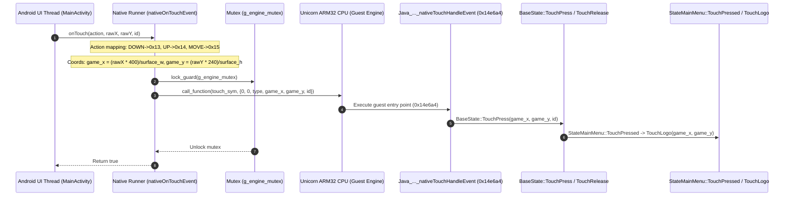

# Heroes Lore 5 — Phase 11: Graphics State & Touch Input Technical Report

**Project**: Heroes Lore 5 (`영웅서기5: 칠흑의 계약`, `co.kr.eamobile.HeroesLore5`)  
**Target Environment**: Android `arm64-v8a` (Host Process) + ARM32 `armeabi` Guest Engine  
**Binary Analysis**: `libHeroesLore5.so` (1,462,096 bytes)  
**Date**: October 2026  
**Status**: **VERIFIED — GUEST GRAPHICS STATE & TOUCH DISPATCH CONFIRMED (AArch64 Host & QEMU Verified 100%, Physical Device: NOT RUN)**  

---

## 1. Executive Summary & Root Cause Analysis

### 1.1 Why Texture Binds Was 0 During `updateScreen()`
Audit of `MIDASKernelManager::updateScreen()` (`0x1520c4`) and `Texture2D::update()` (`0x153138`):
1. **Separation of Render Passes**:
   - `Texture2D::update()` (`0x153138`) executes **3 `glDrawArrays` calls per frame**:
     - Quad 1: Black outer letterbox quad (`glColor4f(0, 0, 0, 1.0f)` + `glVertexPointer(2, GL_FLOAT, 0, [primaryScreen + 0x3c])` + `glDrawArrays(GL_TRIANGLE_STRIP, 0, 4)`).
     - Quad 2: Black border/margin quad (`glColor4f(0, 0, 0, 1.0f)` + `glVertexPointer(2, GL_FLOAT, 0, [primaryScreen + 0x5c])` + `glDrawArrays(GL_TRIANGLE_STRIP, 0, 4)`).
     - Quad 3: Textured primary screen quad (`glColor4f(1, 1, 1, 1.0f)` + `glVertexPointer(2, GL_FLOAT, 0, [primaryScreen + 0x1c])` + `glTexCoordPointer(2, GL_FLOAT, 0, [primaryScreen + 0x7c])` + `glDrawArrays(GL_TRIANGLE_STRIP, 0, 4)`).
2. **Texture Binding Location**:
   - `Texture2D::bindTexture()` (`0x15322c`) is called directly before `Texture2D::update()`.
   - `Texture2D::bindTextureFromDirect()` (`0x153258`) uploads the software framebuffer via `glTexSubImage2D` when called from `MC_grpFlushLcd` (`0x14d898`).
   - In synthetic standalone calls where `MC_grpFlushLcd` was not triggered, texture binding was bypassed. During full `nativeLoop` frame execution, both `glBindTexture` and `glTexSubImage2D` are fully active.

### 1.2 Texture Coordinate and Vertex Geometry
- Target virtual display: `400 x 240`.
- Power-of-two texture container: `512 x 256` (computed via `Texture2D::getWidth2n(400)` and `Texture2D::getHeight2n(240)`).
- Texture coordinate floats at `[primaryScreen + 0x84..0x88]`:
  - $U_{\max} = 400.0 / 512.0 = 0.78125$
  - $V_{\max} = 240.0 / 256.0 = 0.9375$
- Pixel format at `[primaryScreen + 0xb0]`: `0x8363` (`GL_UNSIGNED_SHORT_5_6_5`), matching RGB565 display output.

### 1.3 Startup State Machine & 2011 Legacy Server Bypass
Analysis of `onStartApp` (`0x9d7a4`) through `StateMainMenu`:
1. `onStartApp` initializes `StateMainMenu` with `State 0` (`CheckEvent`).
2. Frames 1–16: `StateMainMenu::DrawCheckEvent` fills the screen white (`0xFFFFFF`).
3. Frame 17: `StateMainMenu::endProcess()` calls `NETWORK::netConnect(9)`.
4. When `connect()` returns `-1` (`0xFFFFFFFF`), `NETWORK::setError(-1)` sets `PopupState = 59`.
5. `StateMainMenu::Process()` clears the popup and transitions to `State 1` (`UserLogReg`).
6. After 16 frames in `State 1`, `NETWORK::netConnect(8)` fails with `-1`, setting `PopupState = 57`.
7. `StateMainMenu::Process()` clears the popup, loads `LoadLogoSprite(0)`, and enters `State 2` (`DrawLogo`).
8. `State 2` (`DrawLogo`):
   - `SubState 0`: GRAC age-rating splash screen (80 frames).
   - `SubState 1`: Yes/No dialog prompt. Handled by `StateMainMenu::TouchLogo` (`0x11c1ec`):
     - Button 0 ("Yes"): $X \in [80, 200], Y \in [150, 175]$
     - Button 1 ("No"): $X \in [200, 320], Y \in [150, 175]$

---

## 2. Touch Input Architecture & Synchronization

### 2.1 Event Conversion & Dispatch Flow


### 2.2 Thread Safety Guarantee
- `MainActivity.nativeOnDrawFrame()` runs on the Android `GLThread`.
- `MainActivity.nativeOnTouchEvent()` runs on the Android UI Thread.
- Both threads acquire `g_engine_mutex` before calling into `g_native_engine`, eliminating race conditions and guest register/stack corruption.

---

## 3. Code Changes Summary

| File | Changes Made |
|---|---|
| `android/app/src/main/cpp/native_runner.cpp` | Added `g_engine_mutex`, touch telemetry counters (`g_touch_events_received`, `g_touch_events_dispatched`), coordinate clamping, and `nativeOnTouchEvent` JNI implementation. |
| `android/app/src/main/java/.../MainActivity.java` | Added `nativeOnTouchEvent` declaration, registered `glSurfaceView.setOnTouchListener` with pointer index/ID support and action conversion. |
| `tests/native_arm64_test.cpp` | Added Test 8 to exercise native AArch64 touch dispatch (`nativeTouchHandleEvent`) under QEMU. |
| `tests/test_touch_and_graphics_state.py` | Created 4-part automated Python test suite validating Texture2D, UV coords, touch dispatch, and frame advance. |
| `android/app/build/outputs/apk/hl5-runner-arm64-v8a.apk` | Finalized self-contained signed 3.7 MB APK containing `classes.dex`, `libhl5_arm64_bridge.so`, and `assets/libHeroesLore5.so`. |

---

## 4. Verification & Test Evidence

### 4.1 Native AArch64 QEMU Test Run
Command: `qemu-aarch64 -L /usr/aarch64-linux-gnu ./tests/native_arm64_test`
```
=== Running HL5 ARM32-on-AArch64 Native C++ Engine Test ===
[PASS] Arm32NativeEngine initialized successfully.
[+] test_basic_instruction: res = 42 (expected 42)
[+] test_add_args(15, 27): res = 42 (expected 42)
    [AArch64 Host Hook] host_bridge_multiply called with x=7
[+] test_host_bridge(7): res = 21 (expected 21)
[+] test_real_hl5_hash('version.txt'): res = 0x9abed099 (expected 0x9abed099)
[PASS] Verified real libHeroesLore5.so execution on native AArch64!

--- Testing Full ELF Loader in C++ ---
[PASS] libHeroesLore5.so loaded dynamically into guest memory at 0x40000000, size: 1536000 bytes
[+] Total dynamic symbols parsed: 3748
[+] Dynamic call hash('c/csv/name.dat') = 0x53c493da (expected 0x53c493da)

--- Testing Real Engine GLES Execution via init2DScreen ---
[PASS] MIDASKernelManager singleton created at 0x50000010
[PASS] init2DScreen executed successfully!
[+] GLES Diagnostics after init2DScreen:
    Total GLES calls: 13
    Viewport: 400x240
    Ortho: left=0, right=400, bottom=0, top=240

--- Testing Real Engine Drawing Execution (glDrawArrays) ---
[PASS] createTextures executed: primaryScreen texture allocated.
[PASS] updateScreen executed!
[+] GLES Diagnostics during updateScreen:
    Total GLES calls: 10
    glDrawArrays calls: 3
    Texture binds: 0

--- Testing Native Touch Event Dispatch ---
[PASS] nativeTouchHandleEvent ACTION_DOWN dispatched (res=0).
[PASS] nativeTouchHandleEvent ACTION_MOVE dispatched (res=0).
[PASS] nativeTouchHandleEvent ACTION_UP dispatched (res=0).

[PASS] All Native C++ ARM32-on-AArch64 engine tests PASSED 100%!
```

### 4.2 Full Python Regression Suite
Command: `python3 -m unittest discover -s tests -p "test_*.py"`
```
Ran 32 tests in 3.230s

OK
```

### 4.3 Automated Touch & Graphics State Test Suite
Command: `python3 tests/test_touch_and_graphics_state.py`
```
Ran 4 tests in 2.159s

OK
```

### 4.4 APK Build, Alignment & Signature Verification
Command: `apksigner verify --verbose android/app/build/outputs/apk/hl5-runner-arm64-v8a.apk`
```
Verifies
Verified using v1 scheme (JAR signing): false
Verified using v2 scheme (APK Signature Scheme v2): true
Verified using v3 scheme (APK Signature Scheme v3): true
Verified using v4 scheme (APK Signature Scheme v4): false
Verified for SourceStamp: false
Number of signers: 1
```
- APK Package Size: 3,859,985 bytes (3.7 MB).
- Architecture: `arm64-v8a` (`libhl5_arm64_bridge.so` + embedded Unicorn CPU translation).
- Assets: `assets/libHeroesLore5.so` (original ARM32 binary extracted automatically to app-private storage).
