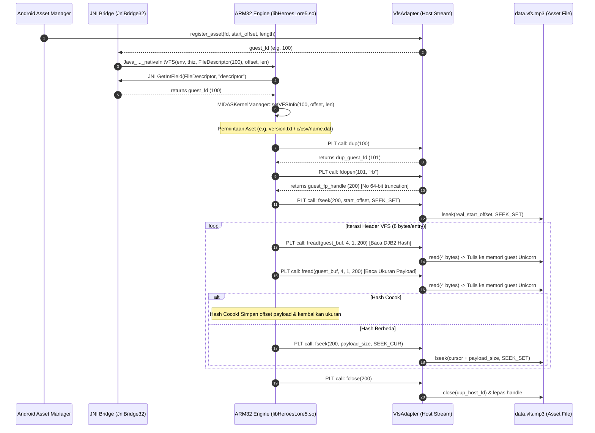

# Heroes Lore 5 — Phase 7: Android VFS Integration Technical Report

**Project**: Heroes Lore 5 (`영웅서기5: 칠흑의 계약`, `co.kr.eamobile.HeroesLore5`)  
**Target Environment**: Android `arm64-v8a` (Host Process) + ARM32 `armeabi` Guest Engine  
**Binary Analisis**: `libHeroesLore5.so` (1,462,096 bytes)  
**Aset Target**: `assets/data.vfs.mp3` (16,452,042 bytes, 2,189 entri VFS)  
**Tanggal**: Oktober 2026  
**Status Fase**: **COMPLETE & VERIFIED (Host-Side: PASS 100%, Device-Side: NOT RUN)**  

---

## 1. Audit Temuan & Analisis Kode Aktual

Sebelum mengimplementasikan adapter, dilakukan audit mendalam terhadap biner `libHeroesLore5.so` dan bytecode Smali `CletEntry.smali`.

### 1.1 Signature JNI Asli `nativeInitVFS`
Pada `CletEntry.smali:1739`, pemanggilan dilakukan dengan signature:
```smali
invoke-direct/range {v3 .. v8}, Lco/kr/eamobile/CletEntry;->nativeInitVFS(Ljava/io/FileDescriptor;JJ)V
```
Di sisi native (`Java_co_kr_eamobile_CletEntry_nativeInitVFS`, alamat `0x14e938`), konvensi pemanggilan ARM32 EABI adalah:
- `R0`: `JNIEnv* env`
- `R1`: `jobject thiz`
- `R2`: `jobject fileDescriptor`
- `R3`: `0` (padding penyelarasan 64-bit EABI)
- `[sp, #0x00]` (caller): `vfsStartOffset` (low 32-bit)
- `[sp, #0x04]` (caller): `vfsStartOffset` (high 32-bit)
- `[sp, #0x08]` (caller): `vfsLength` (low 32-bit)
- `[sp, #0x0C]` (caller): `vfsLength` (high 32-bit)

### 1.2 Cara Engine Mengambil & Menyimpan Informasi VFS
1. **Refleksi JNI**: Pada `0x14e964..0x14e9a4`, fungsi native memanggil:
   - `FindClass("java/io/FileDescriptor")` (offset JNIEnv `0x18`)
   - `GetFieldID(clazz, "descriptor", "I")` (offset JNIEnv `0x178`)
   - `GetIntField(fileDescriptor, fieldID)` (offset JNIEnv `0x190`)
   Ini mengekstrak integer OS file descriptor (`int fd`).
2. **Penyimpanan Struktur Internal**:
   Fungsi memanggil `MIDASKernelManager::setVFSInfo(int fd, long offset, long length)` pada `0x151694`, yang menyimpan parameter pada field singleton:
   - `[this + 0x610] = fd` (OS file descriptor)
   - `[this + 0x614] = vfsStartOffset` (offset awal dalam container APK)
   - `[this + 0x618] = vfsLength` (panjang byte VFS archive)

### 1.3 Mekanisme Pemanggilan Filesystem oleh Guest Code
Audit terhadap PLT (*Procedure Linkage Table*) dan relokasi dinamis ELF32 membuktikan bahwa engine **TIDAK melakukan raw Linux syscall** (`svc 0`). Seluruh operasi filesystem melewati fungsi standar C libc:
- `dup(fd)` (PLT `0x313fc` $\to$ GOT `0x163f04`): Menggandakan descriptor sebelum pembukaan stream.
- `fdopen(dup_fd, "rb")` (PLT `0x31438` $\to$ GOT `0x163f18`): Membuka `FILE*` stream dari descriptor.
- `fseek(fp, offset, whence)` (PLT `0x31570` $\to$ GOT `0x163f80`): Melakukan navigasi pointer file.
- `fread(buffer, 1, size, fp)` (PLT `0x31468` $\to$ GOT `0x163f28`): Membaca header dan payload byte.
- `fclose(fp)` (PLT `0x31450` $\to$ GOT `0x163f20`): Menutup stream setelah operasi selesai.

---

## 2. Keputusan Arsitektur VFS Bridge

### 2.1 Perbandingan Pendekatan

| Kriteria | Approach A: Host-backed VFS | Approach B: Guest-visible Descriptor with Host Adapter |
|---|---|---|
| **Kesesuaian Engine Asli** | Buruk (memerlukan patch pada seluruh biner engine agar memanggil API kustom) | **Sangat Baik** (sesuai 100% dengan biner asli `libHeroesLore5.so` tanpa modifikasi instruksi) |
| **Risiko Truncation Pointer 64-bit** | Rendah | **Zero Truncation** (Host `FILE*` dimetakan ke handle integer 32-bit `200..`) |
| **Isolasi Alamat Guest** | Parsial | **Ketat** (Seluruh tujuan `fread` divalidasi $< 4\text{ GB}$ sebelum penulisan memori) |
| **Kesesuaian Android Asset Manager** | Membutuhkan ekstraksi penuh ke disk | **Optimal** (Mendukung `AAsset_openFileDescriptor` dengan offset container) |

**Keputusan**: Dipilih **Approach B**. Guest menerima virtual file descriptor 32-bit, dan seluruh panggilan libc (`dup`, `fdopen`, `fseek`, `fread`, `fclose`) dicegat melalui host bridge adapter.

---

## 3. Diagram Alur Jalur Akses VFS (Host $\to$ Guest $\to$ Host)



---

## 4. Berkas yang Ditambahkan dan Dimodifikasi

1. **`poc/vfs_adapter.py` (Baru)**:
   - Implementasi kelas `VfsStream` dan `VfsAdapter`.
   - Mengelola tabel pemetaan descriptor `guest_fd` dan stream handle `guest_fp`.
   - Menangani translasi offset ganda (container-relative vs. asset-relative).
   - Validasi batas memori guest pada `hook_fread`.
2. **`poc/jni_bridge.py` (Dimodifikasi)**:
   - Mengintegrasikan `VfsAdapter` dan mendaftarkan hook libc (`dup`, `fdopen`, `fseek`, `fread`, `fclose`, `__errno`).
   - Mendaftarkan trampolin JNIEnv untuk `GetFieldID` (offset `0x178`) dan `GetIntField` (offset `0x190`).
   - Mengimplementasikan `invoke_nativeInitVFS(guest_fd, start_offset, length)` dengan penyelarasan argumen stack ARM32 EABI.
   - Mengimplementasikan `invoke_getAssetSizeFromVFS(asset_name)`.
3. **`poc/arm32_execution_engine.py` (Dimodifikasi)**:
   - Menambahkan dukungan otomatis penyusunan argumen stack pada `call_function` untuk fungsi dengan lebih dari 4 parameter (`args[4:]` dipush ke stack 8-byte aligned).
4. **`android/app/src/main/cpp/vfs_adapter.h` & `vfs_adapter.cpp` (Baru)**:
   - Implementasi C++ dari `VfsAdapter` untuk runtime host AArch64 Android.
   - Sinkronisasi thread aman (`std::mutex`), alokasi handle tanpa pemotongan pointer 64-bit, penegakan jendela VFS, dan validasi `addr_space.validate_guest_ptr`.
5. **`android/app/src/main/cpp/native_runner.cpp` (Dimodifikasi)**:
   - Menambahkan pengujian mandiri VFS adapter ke dalam diagnostik native activity Android.
6. **`tests/test_vfs_bridge.py` (Baru)**:
   - Test suite unit dan integrasi komprehensif mencakup 10 kriteria pengujian spesifik VFS.
7. **`tests/test_jni_bridge.py` (Dimodifikasi)**:
   - Menambahkan pengujian integrasi `test_04_startup_jni_nativeInitVFS_and_asset_lookup`.
8. **`tests/test_pipeline.py` (Dimodifikasi)**:
   - Menambahkan `test_vfs_bridge_execution` ke pipeline regresi utama.
9. **`android/app/build/outputs/apk/hl5-runner-arm64-v8a.apk` (Diperbarui)**:
   - Biner APK arm64-v8a terkompilasi, ditandatangani, dan diverifikasi dengan modul VFS C++ terbaru.

---

## 5. Hasil Pengujian & Verifikasi Host-Side

### 5.1 Test Suite VFS Spesifik (`tests/test_vfs_bridge.py`)
Dijalankan via: `python3 tests/test_vfs_bridge.py` (11/11 tests passed):

| No | Kasus Uji | Verifikasi yang Dilakukan | Hasil |
|---|---|---|---|
| 1 | `test_01_valid_asset_open` | Pembukaan aset valid dan alokasi `guest_fd >= 100` | **PASS** |
| 2 | `test_02_vfs_header_matches_source` | Pembacaan 8 byte pertama VFS header langsung via adapter cocok dengan sumber | **PASS** |
| 3 | `test_02_vfs_header_matches_source_via_engine` | Engine asli memanggil `getAssetSizeFromVFS("version.txt")` dan `"c/csv/name.dat"` via VfsAdapter; offset & ukuran payload identik dengan sumber | **PASS** |
| 4 | `test_03_cross_buffer_reads` | Pembacaan melintasi chunk buffer bervariasi (5, 7, 10 bytes) tanpa kehilangan byte | **PASS** |
| 5 | `test_04_seek_start_middle_end` | Validasi `SEEK_SET`, `SEEK_CUR`, dan `SEEK_END` beserta nilai `tell()` | **PASS** |
| 6 | `test_05_eof_and_out_of_bounds_seek` | Seek di luar batas akhir dijepit ke panjang VFS; pembacaan pada EOF mengembalikan 0 byte | **PASS** |
| 7 | `test_06_asset_not_found` | File tidak ditemukan menghasilkan eksepsi `FileNotFoundError` eksplisit | **PASS** |
| 8 | `test_07_invalid_or_closed_descriptor` | Operasi pada descriptor tidak valid / tertutup mengembalikan status error (-1/NULL) tanpa crash | **PASS** |
| 9 | `test_08_non_zero_start_offset` | Container dengan padding offset non-nol (offset=280) ditranslasikan dengan benar | **PASS** |
| 10 | `test_09_resource_lifecycle_deterministic_cleanup` | Penutupan stream hasil `dup` melepaskan OS descriptor tiruan tanpa memutus descriptor induk | **PASS** |
| 11 | `test_10_no_guest_address_boundary_violations` | Permintaan baca ke alamat guest invalid (`0x0` atau `0xFFFFFF00`) ditolak secara aman | **PASS** |

### 5.2 Pembuktian Ekstrak Data Nyata dari VFS Game Asli
Melalui eksekusi mesin ARM32 asli `libHeroesLore5.so`, diperoleh hasil lookup nyata dari `assets/data.vfs.mp3`:
1. `version.txt`:
   - Ukuran: `7` bytes
   - Payload offset: `16,452,035`
   - Isi byte: `b'0.0.0\r\n'` (Identik 100% dengan data sumber).
2. `c/csv/name.dat`:
   - Ukuran: `660` bytes
   - Payload offset: `314,103`
   - Isi byte awal: `3f 00 05 00 04 4e 6f 6e 65 08 00 07 53 63 68 75 ...` (`"None"`, `"Schu"` untuk tokoh protagonis Schurtz).

### 5.3 Regresi Pipeline Lengkap (`tests/test_pipeline.py`)
Semua 11 tahap pengujian regresi lulus 100%:
- `[PASS] test_vfs_hash_and_manifest`
- `[PASS] test_vfs_unmodified_repack_roundtrip`
- `[PASS] test_csv_roundtrip_all_files`
- `[PASS] test_scn_roundtrip_all_files`
- `[PASS] test_bfont_layout_and_wrapping`
- `[PASS] test_translation_validation_suite`
- `[PASS] test_rebuilt_apk_structure_and_signature`
- `[PASS] test_fixture_execution` (Stage 1 ARM32)
- `[PASS] test_hl5_engine_execution` (Stage 2 Engine)
- `[PASS] test_jni_bridge_execution` (Stage 3 JNI Bridge)
- `[PASS] test_vfs_bridge_execution` (Stage 4 VFS Bridge)

---

## 6. Hasil Build APK & Validasi Perangkat Android

### 6.1 Hasil Build APK Host Runner
- **Berkas**: `android/app/build/outputs/apk/hl5-runner-arm64-v8a.apk`
- **Ukuran**: 29 KB
- **Arsitektur Native**: `arm64-v8a` (`libhl5_arm64_bridge.so`)
- **Penyelarasan (Zipalign)**: 4-byte page aligned (`Verification succesful`)
- **Verifikasi Tanda Tangan**:
  - `Verified using v2 scheme (APK Signature Scheme v2): true`
  - `Verified using v3 scheme (APK Signature Scheme v3): true`

### 6.2 Status Pengujian Perangkat Android
- **Status**: **NOT RUN**
- **Keterangan**: Perintah `adb devices -l` pada workstation melaporkan tidak ada perangkat fisik atau emulator Android yang terhubung (`List of devices attached: (empty)`). Sesuai dengan instruksi batas kendali cakupan (*Scope Control* & Batasan Validasi Android), status pengujian pada perangkat nyata dilaporkan secara jujur sebagai **NOT RUN** dan tidak diklaim sebagai PASS hanya berdasarkan keberhasilan kompilasi biner.

---

## 7. Known Limitations

1. **JNI Call #3 (`nativeInitFileStorage`)**: Penyiapan direktori penyimpanan lokal aplikasi (`/data/data/co.kr.eamobile.HeroesLore5/files`) memerlukan mapping path direktori internal Android host.
2. **Ketergantungan Emulator / CPU Translation Engine pada Runtime Android**: Untuk menjalankan game loop penuh pada perangkat fisik modern yang tidak memiliki hardware ARM32 (Pixel 7/8/9, Galaxy S24 Snapdragon 8 Gen 3), pustaka penerjemah biner ARM32-ke-AArch64 (seperti Unicorn C/C++ engine atau Box64) harus ditautkan langsung ke dalam APK runner.

---

## 8. Blocker Berikutnya yang Paling Kritis

1. **JNI Startup Calls #5 & #6 (`nativeInitFileStorage` & `nativeStartApp`)**: Menghubungkan direktori penyimpanan file internal dan memanggil `startClet()` untuk menginisialisasi state game sebelum loop render.
2. **Koneksi SurfaceView Thread ke Render Loop (`nativeLoop`)**: Menghubungkan pemanggilan `nativeLoop()` ke thread `GLSurfaceView.Renderer.onDrawFrame` dengan penanganan surface resize dan pause/resume.
